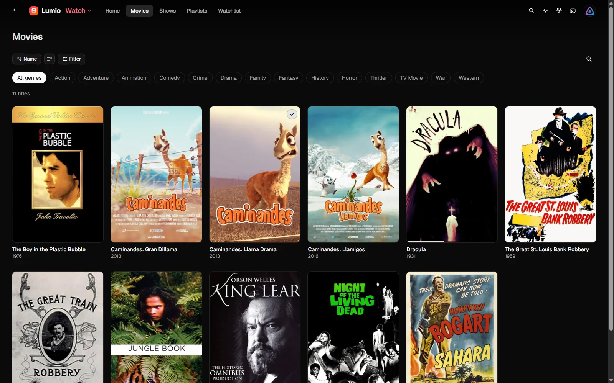
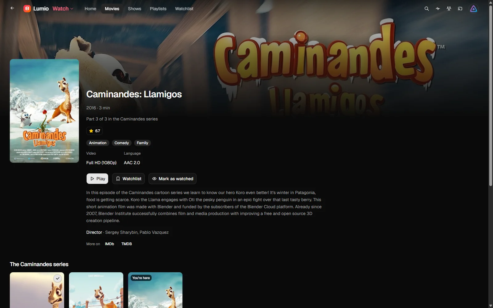
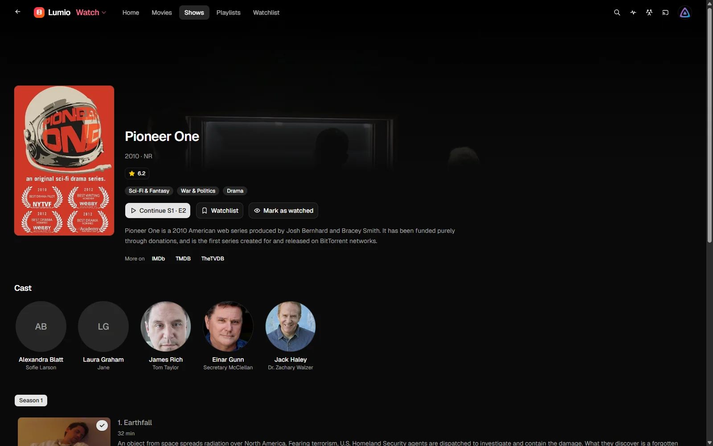
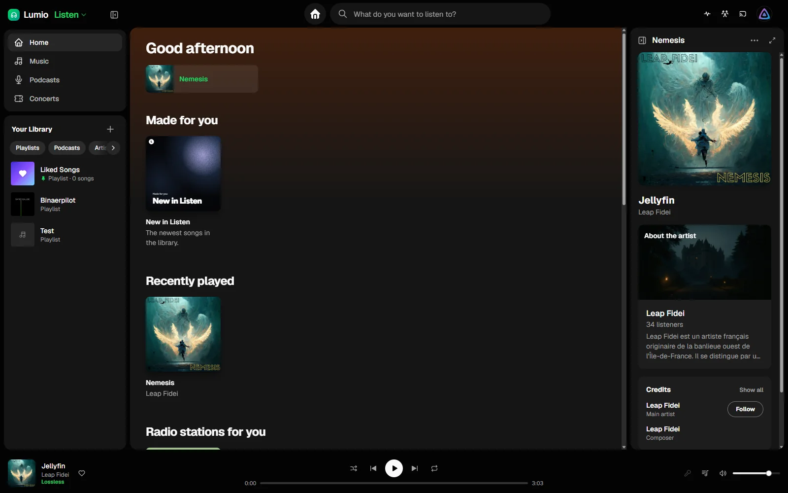
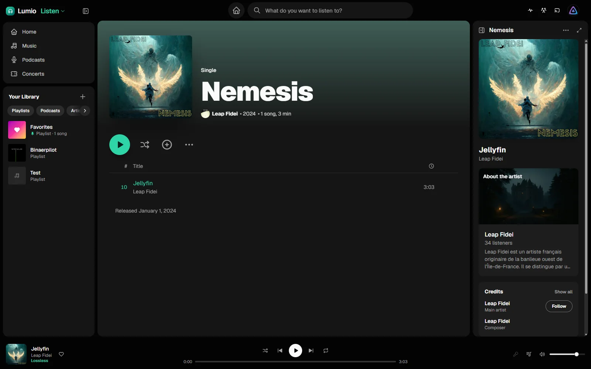
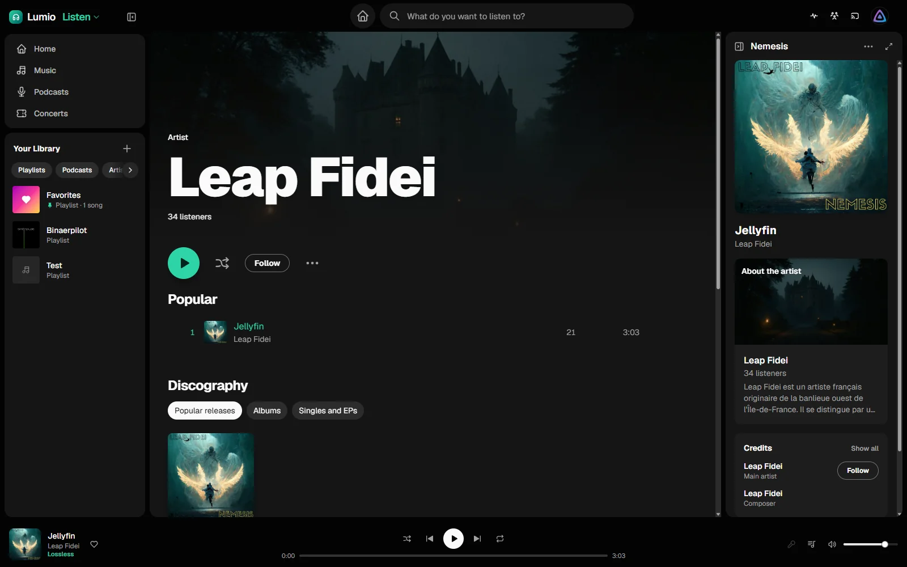
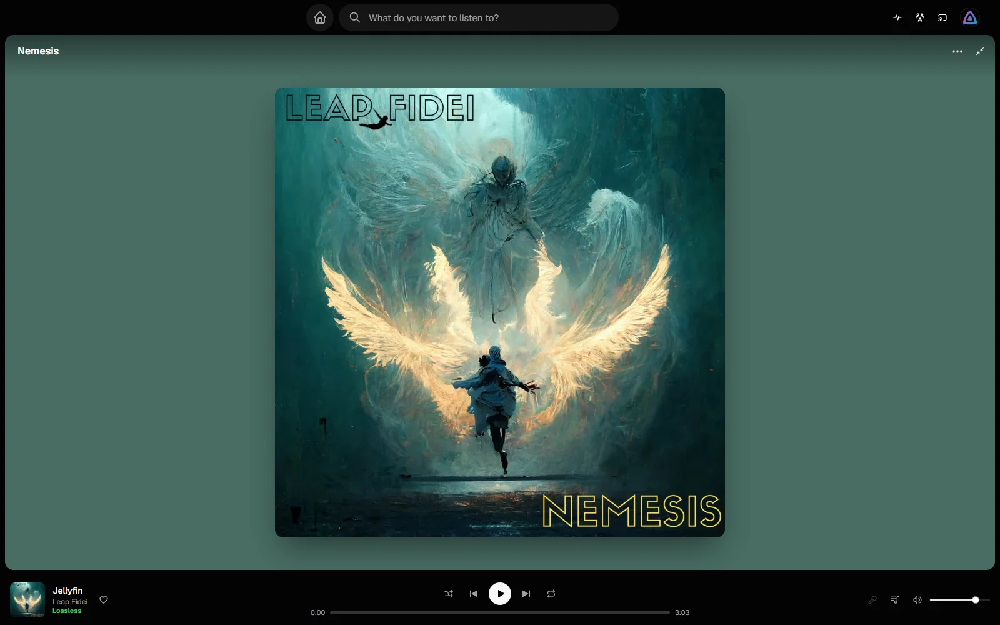

# Lumio

A from-scratch Jellyfin web client with a shadcn/ui-inspired, cinematic interface. It talks to a stock Jellyfin
server (tested against 10.11) and needs no server plugin of its own.

## Setup

Lumio runs as one container in front of Jellyfin and becomes its public face (Jellyfin's API, apps and administration keep working through it). See **[docs/SETUP.md](docs/SETUP.md)** for the bare minimum and the recommended setup (SSO, Meilisearch, Intro Skipper, keys).

## Screenshots

Taken against the public [Jellyfin demo server](https://demo.jellyfin.org/stable) (freely licensed films and music;
film stills © Blender Foundation, CC BY).

### Watch

| | |
| --- | --- |
|  |  |
|  |  |

### Listen

| | |
| --- | --- |
|  |  |
|  |  |

## Features

- **Personal home**: rows built from the watch history (continue, "because you watched", favourite genres, a genre to
  discover, recently added); Jellyfin's classic "latest per library" layout is still available. Libraries can be
  reordered and hidden.
- **Two languages**: German and English, following the browser or chosen in the settings (also on the sign-in page).
- **Branding and plugins (admins)**: app name, logo, favicon, accent color and custom CSS for everyone on the server,
  plus JavaScript plugins that can add to, change or remove parts of the UI (see "Plugins" below).
- **Browsing**: libraries with sorting, genre and watched filters and infinite scroll,
  detail pages with cast and guest stars, seasons and episodes, person pages, a watchlist (favorites) and a searchable
  watch history.
- **Search**: inline search in the header and a full search page.
- **Hover previews**: Netflix-style cards that load their content before they appear.
- **Ratings and links**: IMDb/TMDB ratings and external links. The real TMDB rating needs a key on the server, see below.
- **Player**: a custom player built on hls.js.
  - Audio, subtitle and quality menus.
  - Trickplay thumbnails, intro/outro skipping (media segments) and an in-player episode list.
  - A pause spotlight and a loading progress ring.
  - Readable track names ("Deutsch · Dolby Digital 5.1" instead of the file's stream titles).
- **Settings**: mirrors jellyfin-web's profile, playback, subtitle and controls pages.
  - Account-wide settings are stored in the Jellyfin user configuration.
  - Device-specific settings stay in the browser.
- **Watch together and remote control**: SyncPlay groups ("Einer Gruppe beitreten") and controlling other Jellyfin
  sessions ("Abspielen auf"). Other clients can also cast to Lumio.
- **Sign-in**: Quick Connect, which is how SSO setups such as Authentik sign in, or a username and password.
- **Administration**: admins get links to the Jellyfin dashboard and metadata manager.

## Stack

- Vite, React 19, TypeScript
- Tailwind CSS v4 and shadcn/ui (on Base UI), Tabler icons
- `@jellyfin/sdk` for the API, TanStack Query for data fetching
- React Router: a data router, which is what makes view transitions between pages possible
- hls.js for transcoded streams; direct play uses the browser itself

## Development

Lumio always runs with its server (`server/`): it serves the app and, under `/api`, what Jellyfin can't share between
users (follows, followers, privacy settings, live friend activity). It needs Node 24 and nothing else (SQLite and
TypeScript support are built in). In development, run it next to Vite, which passes `/api` on to it:

```sh
cp .env.example .env   # at least set VITE_JELLYFIN_URL
pnpm install
JELLYFIN_URL=https://jellyfin.example.org node --no-warnings server/src/main.ts   # terminal 1
pnpm dev                                                                          # terminal 2
```

In production, build the app and let the server serve it (or use the `Dockerfile`, which does both):

```sh
pnpm build
JELLYFIN_URL=https://jellyfin.example.org PORT=8097 DATA_DIR=/var/lib/lumio node --no-warnings server/src/main.ts
```

| Server variable   | Required | Purpose                                                                                       |
| ----------------- | -------- | --------------------------------------------------------------------------------------------- |
| `JELLYFIN_URL`    | yes      | The Jellyfin server whose tokens it accepts (every API request is checked with it).          |
| `PORT`            | no       | Port to listen on (default 8097).                                                             |
| `DATA_DIR`        | no       | Where it keeps its SQLite database and caches (podcast covers, relayed answers; default `./data`). |
| `WEB_DIR`         | no       | The built app it serves (default `dist/` of this repository).                                 |
| `ALLOWED_ORIGINS` | no       | Comma-separated origins allowed to call the API from elsewhere (only for split setups).       |
| `LASTFM_API_KEY`  | no       | Last.fm key (free, non-commercial): listeners, popular songs, similar artists, bios, charts. The app asks Last.fm through the server. |
| `TICKETMASTER_API_KEY` | no  | Ticketmaster Discovery key (free): concerts. The app asks through the server.                  |
| `TMDB_API_KEY`    | no       | TMDb key: TMDb ratings and film series names. The app asks through the server.                 |
| `PROXY_JELLYFIN`  | no       | `true`: Lumio fronts Jellyfin and passes its API, WebSockets, `/web` and `/sso` through (see [docs/SETUP.md](docs/SETUP.md)). |
| `SSO_PROVIDERS`   | no       | Sign-in buttons for the Jellyfin SSO plugin's providers, `name:Label` separated by commas.      |
| `DISABLE_PASSWORD_LOGIN` | no | `true` (with SSO providers): the sign-in page offers SSO and Quick Connect only.               |
| `MUSICBRAINZ_CONTACT` | no  | A URL or e-mail address MusicBrainz can reach the operator at (it throttles anonymous clients). |

The server relays and caches what the app asks Ticketmaster (6 h), Last.fm (artists 90 days, charts 24 h), MusicBrainz
(artist links and song credits, 180 days) and lrclib (lyrics, 180 days) for, podcast feeds with their chapters and transcripts (6 h / 30 days), and
podcast covers from Apple (kept), so one listener's lookup is there at once for everyone and the services' limits are
kept centrally.

| Script           | What it does                         |
| ---------------- | ------------------------------------ |
| `pnpm dev`       | Dev server with hot reload           |
| `pnpm build`     | Type check and production build      |
| `pnpm typecheck` | Type check only                      |
| `pnpm lint`      | oxlint                               |
| `pnpm preview`   | Serve the production build           |

### Environment variables

| Variable                        | Required | Purpose                                                                                                                                   |
| ------------------------------- | -------- | ----------------------------------------------------------------------------------------------------------------------------------------- |
| `VITE_JELLYFIN_URL`             | yes      | The Jellyfin server shown on the login screen.                                                                                            |
| `VITE_SERVER_LOCKED`            | no       | `true` pins the login to `VITE_JELLYFIN_URL` and hides the server field (ignored when no URL is set).                                     |
| `VITE_TMDB_API_KEY`, `VITE_LASTFM_API_KEY`, `VITE_TICKETMASTER_API_KEY` | no | Only for builds that ask those services directly (no Lumio server); they end up in the client bundle. Normally the keys belong on the server (above). |
| `VITE_PASSWORD_CHANGE_DISABLED` | no       | `true` hides "Passwort ändern", e.g. when accounts live in an OIDC provider.                                                              |
| `VITE_ACCOUNT_URL`              | no       | Where users manage their account instead (for example the Authentik user settings). Quote it if it contains a `#`. |
| `VITE_SOCIAL_URL`               | no       | Address of the Lumio server's API when the app is served from somewhere else (default: the same origin's `/api`). |

All of these are read at build time; changing them needs a rebuild.

## Structure

```
src/
  App.tsx                 routes (data router), query client, providers
  components/
    app-shell.tsx         header, navigation, profile menu
    media/                cards, rows, grids, hover preview, rating badges
    ui/                   shadcn components (generated, then adjusted)
  features/
    auth/                 session storage, login, Quick Connect
    home/                 home screen and hero
    items/                detail page, item queries, preview preloading
    library/              libraries, watchlist, history, person pages
    player/               player page, controls, panels, device profile, segments, trickplay
    remote/               remote control ("Abspielen auf") and SyncPlay over the Jellyfin WebSocket
    search/               header search and search page
    settings/             settings pages; local (per-browser) and server-side user settings
  lib/                    SDK setup, config, formatting, image URLs, TMDB, track labels
```

### Notes

- **Device profile**: `features/player/device-profile.ts` builds the profile by hand from `canPlayType`/MSE
  checks. The SDK helper only covers subtitles. Jellyfin uses the profile to decide between direct play and
  transcoding.
- **Settings storage**: settings jellyfin-web keeps per device (bitrate limit, skip lengths, subtitle look) are
  stored in `localStorage` per user. Account-wide ones (audio/subtitle language, autoplay) go to the server.
- **Tabs**: several Lumio tabs in one browser share a device id, and with it one server session. That matters for
  SyncPlay and remote control.

### Plugins

Admins add plugins under Settings → Plugins, as an ES module URL or as code. A module exports `setup(lumio)`:

```js
export default function setup(lumio) {
  lumio.addStyle('.hero h1 { color: gold }')
  lumio.addNavLink({ id: 'requests', label: 'Requests', href: 'https://requests.example.com', external: true })
  lumio.addMenuItem({ id: 'help', label: 'Help', href: '/plugin/help' })
  lumio.addRoute({ path: 'help', render: (element) => { element.textContent = 'Help' } })
  lumio.addSlot('item:bottom', (element, { item }) => { element.textContent = item.Name })
  lumio.hide('header:cast')
  lumio.transform('homeRows', (rows) => rows.filter((row) => row.id !== 'new'))
  lumio.on('playback:start', ({ itemId }) => console.log('playing', itemId))
}
```

- Slots: `header:start`, `header:end`, `home:top`, `home:bottom`, `item:actions`, `item:bottom`, `player:overlay`.
- Hideable: `header:search`, `header:syncplay`, `header:cast`, `nav:home`, `nav:watchlist`, `nav:<category>` (`movies`, `shows`, `anime`, `music`, `audiobooks`, `books`, `videos`), `nav:<library id>`,
  `home:hero`, `home:<row id>`, `item:ratings`, `item:links`.
- Events: `navigate`, `item`, `playback:start`, `playback:stop`.
- `lumio.jellyfin` gives the signed-in session (`api`, `serverUrl`, `userId`, `accessToken`, `isAdmin`).

Branding and plugins are stored in the Jellyfin server's branding configuration (as one comment inside its custom CSS),
which every client can read (even before signing in) and only admins can write. jellyfin-web only sees a CSS comment.

## License and notices

Lumio is free software under the [GNU General Public License v3.0](LICENSE).

It is an independent project, not affiliated with or endorsed by Jellyfin, TMDb, Last.fm, Ticketmaster, MusicBrainz,
Epidemic Sound, Deezer, lrclib or Rotten Tomatoes. Names and data of those services belong to their owners. Whoever
runs Lumio with keys for those services uses their own keys and keeps to their terms (attribution where asked; Last.fm
for non-commercial use only).
